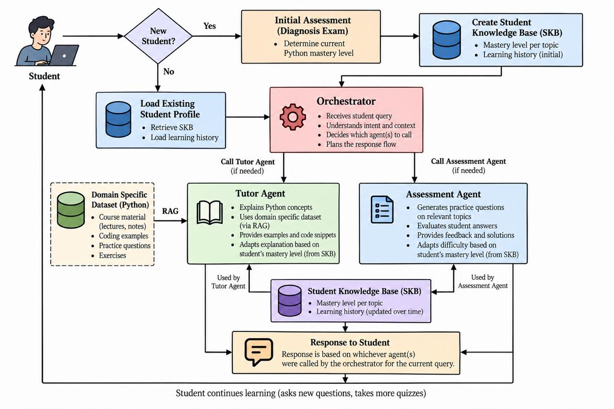

# Personalised Python Tutor Using Student Knowledge Modelling

An agentic Python-learning tutor that adapts explanations and practice to each student's knowledge level. It combines a central **Orchestrator**, a **Student Knowledge Base (SKB)**, **Retrieval-Augmented Generation (RAG)**, and small language models (SLMs).

## Architecture

  

A new student first completes a one-time diagnosis assessment, which creates their SKB. For returning students, the existing profile and learning history are loaded. The Orchestrator then routes each request to the relevant component:

- **Tutor Agent:** Explains concepts and provides hints using course material retrieved through RAG. Its teaching style is adjusted using the student's topic mastery and misconceptions.
- **Assessment Agent:** Selects difficulty-appropriate MCQs, grades submitted answers against stored answer keys, and updates the student's learning record.
- **Student Knowledge Base:** Stores topic-level mastery, supporting evidence, recent results, and common mistakes.

The Orchestrator calls only the component needed for the current interaction.

## Data

- **Course corpus:** Python learning material collected from public resources and textbooks, cleaned, chunked, and tagged with topic, difficulty, and source metadata. Stored in `data/common/corpus.jsonl`.
- **MCQ bank:** 455 questions covering 13 topics and 74 subconcepts, with eight question types and difficulty labels. Stored in `python_tutor_mcqs.json`.
- **Retrieval evaluation:** 26 fixed test queries, 22 of which have relevant chunks marked, stored in `retrieval_eval.csv`.

## Retrieval Evaluation

Four retrieval methods were compared on the 26-query test set (top 5 results):

| Method | Recall@5 | MRR | Mean latency |
|---|---:|---:|---:|
| TF–IDF | 0.7379 | 0.7083 | 17.314 ms |
| **BM25** | **0.8356** | 0.7629 | **2.392 ms** |
| Dense | 0.4955 | 0.6818 | 18.788 ms |
| Hybrid (RRF) | 0.7061 | **0.7917** | 25.692 ms |

BM25 is the current default because it achieved the highest Recall@5 and lowest query latency in these experiments. Hybrid retrieval had the best MRR.

## Current Progress

**Implemented:** Orchestrator, initial diagnosis, Tutor Agent with RAG, Assessment Agent, SKB integration, and retrieval comparison.

**Planned:** Error Analysis Agent, full-pipeline evaluation, further ablations, and edge-case improvements.

## Repository

[GitHub Repository](https://github.com/vidhijain0204/LMA_Group_Project)
